<h1>Hi there, I'm Nguyễn Đức Minh 👋</h1>

<h3>Fullstack Developer | Backend-Oriented</h3>

  
  

---

### 🛠️ Tech Stack

  
  
  
  
  
  
  
  
  
  
  
  
  
  
  
  
  
  
  
  

---

### 📊 GitHub Statistics

  
  

---

<i>💡 "Code with purpose, build for impact."</i>
